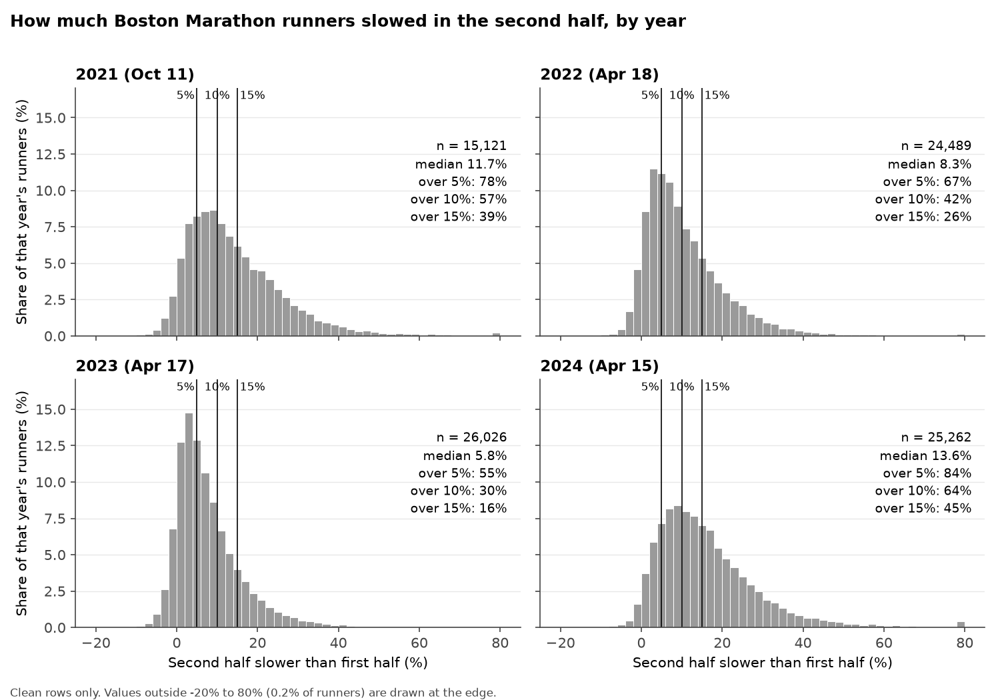
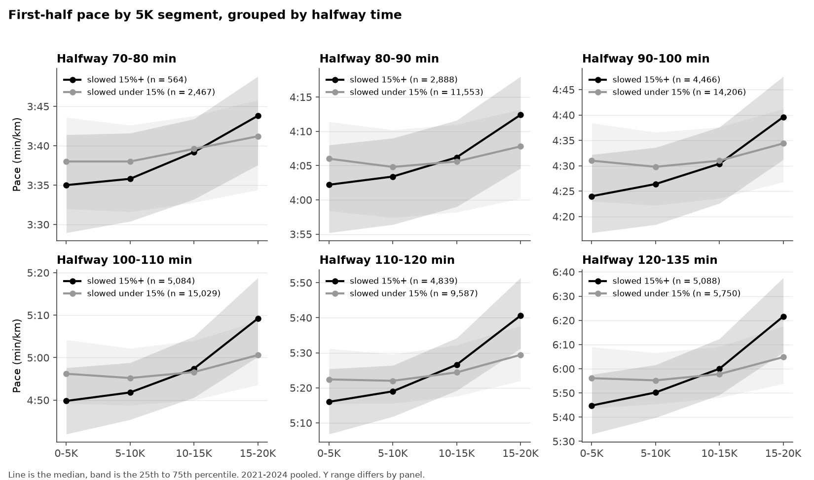

# Predicting the Wall: Early Pacing and Marathon Slowdown

David Ren, CS506, Fall 2026

## Status Update

For the October check-in, the data side of the project is done. The file is downloaded with a checksum recorded, the cleaning rules are written and logged, and the feature table is built. The two figures are further down. I haven't started modeling yet, that comes next.

The code is in `src/`. `download.py` gets the file, `validate.py` cleans it, `features.py` builds the features and the label, and `plots.py` makes the figures. There are tests in `tests/` for the cleaning rules and the feature math, and GitHub Actions runs them on every push.

## What the project is about

Two runners can hit the halfway mark of a marathon at the same time having run very different first halves. One of them might have run every 5K at the same pace, while the other went out hard and got a little slower at each checkpoint. I want to know whether that difference tells you anything about who is going to fall apart in the second half, once you already know the halfway time.

I run, so I have a personal interest in this. The usual way people estimate a finish is to take the halfway time and double it, and I want to see whether the shape of the first half adds anything to that. The result will be a Python analysis anyone can rerun, with the figures and the model comparison in this README.

## What I'm predicting

The thing I'm trying to predict is how much slower a runner's second half was than their first half, as a percentage:

    first_half_seconds = HALF
    second_half_seconds = Finish_Net - HALF
    slowdown_percent = 100 * (second_half_seconds / first_half_seconds - 1)

So a runner who did the first half in 90 minutes and the second half in 99 minutes slowed down 10%. In the proposal I set the cutoff for a substantial slowdown at 10%, with 5% and 15% as checks. After looking at the data (figure 1 below), 10% turns out to be close to the median in most years, meaning about half the field would count as having hit the wall, which isn't what I meant by substantial. So I'm using 15% as the working cutoff for the figures and probably for the models. All three labels are computed and I'll make the final call once I see how the models behave at each one. Either way, the cutoff only measures how much someone slowed down. It doesn't say anything about why.

## Where the data comes from

I'm using the Boston Marathon dataset that Carnegie Mellon's Department of Statistics & Data Science publishes for teaching: [Boston Marathon times, 2021-2024](https://cmustatistics.github.io/data-repository/sports/boston-marathon.html). Each row is one runner in one year, with their age, an M/F field, their cumulative time at every 5K checkpoint from 5K to 40K, their halfway time, their net finish time, and the year. All the times are in seconds.

The data was originally scraped from the Boston Athletic Association's results pages by Brandon Onyejekwe and Eric Gerber at Northeastern for a [paper on predicting finish times](https://github.com/bonyejekwe/Marathon_Predictor). I'm using their data, and all the code in this repo is mine. My question is also different from theirs.

`src/download.py` downloads the file, saves it to `data/raw/` without changing anything, and writes `data/manifest.json` with the URL, the download time, the file size, and the sha256 hash. The raw file is gitignored, but the manifest is committed so anyone can check they have the same file I used. The script also stops with an error if any of the 14 columns from CMU's data dictionary is missing.

Here is what's in the raw file:

| Year | Race date | Rows |
| --- | --- | --- |
| 2021 | Oct 11 | 15,121 |
| 2022 | Apr 18 | 24,489 |
| 2023 | Apr 17 | 26,028 |
| 2024 | Apr 15 | 25,262 |
| Total | | 90,900 |

The 2021 race was held in October because of COVID and had a smaller field, which is why that year has fewer rows. Before writing any cleaning rules I ran `src/inspect_raw.py`, which prints the column types, missing values per column per year, the range of every time column, the values in M/F, the age range, and the number of duplicate rows. The file turned out to be very clean. There are no missing values in any column, every time column is already an integer, nothing is zero or negative, and there are no exact duplicates. M/F has three values: M (51,208), F (39,622), and X (70). Ages run from 18 to 82.

## Cleaning

Even though the file looked clean, I wrote the rules anyway so the cleaning is explicit and repeatable. `src/validate.py` applies four rules in order and counts how many rows each one drops, per year. A row only gets counted against the first rule that catches it, so the counts add up to the total.

| Rule | Why |
| --- | --- |
| Missing 5K, 10K, 15K, 20K, HALF, or Finish Net | These are the columns the features and the label are built from. 25K through 40K are allowed to be missing since they're only used for plots. |
| A zero or negative time | Impossible for a real split. |
| A cumulative time lower than the one before it | You can't reach 40K after you've finished. This is a timing mat problem. |
| An exact duplicate row | The same performance counted twice. |

In total 2 rows were dropped, both from 2023, both because the finish time was lower than the 40K time. That leaves 90,898 rows. The log is written to `data/processed/exclusions.csv`.

The Name column is dropped at this step so that nothing downstream can use it. I'm also deliberately keeping slower runners. Even seven-ish hour finishes are real results, and dropping outliers by eye would push the dataset toward faster runners, who are the people least likely to hit the wall.

## Features

`src/features.py` turns the clean rows into the inputs for the models and the label. Everything used as an input is known by the halfway point. The finish time and the 25K through 40K splits are only used to compute the label and for the retrospective plots.

| Feature | How it's calculated |
| --- | --- |
| Segment paces (4) | Seconds per km for 0-5K, 5-10K, 10-15K, and 15-20K, e.g. `(time_10K - time_5K) / 5` |
| Halfway pace | HALF / 21.0975 |
| Pace variation | Standard deviation of the four segment paces divided by their mean |
| Slowing trend | Percent change from the 0-5K pace to the 15-20K pace |
| Age, M/F | Tested separately as additional inputs |
| Label | `slowed_5`, `slowed_10`, `slowed_15`: 1 if the slowdown is at least that percent |

Here is the share of runners over each cutoff, by year, along with the start temperature from [findmymarathon.com](https://www.findmymarathon.com/weather-detail.php?zname=boston+marathon):

| Year | Median slowdown | Over 5% | Over 10% | Over 15% | Start temp |
| --- | --- | --- | --- | --- | --- |
| 2021 | 11.7% | 78% | 57% | 39% | 60 F, 88% humidity |
| 2022 | 8.3% | 67% | 42% | 26% | 46 F |
| 2023 | 5.8% | 55% | 30% | 16% | 48 F |
| 2024 | 13.6% | 84% | 64% | 45% | 56 F |

The base rate moves around a lot from year to year, and the two warmer races have the highest shares. With only four race days there's no way to use temperature as a real feature, so it stays in the discussion. It does matter for the evaluation though, because 2024 is my planned test year and its base rate is quite different from the 2021 and 2022 training years. That's why I'm planning to report calibration along with average precision.

## Figures

Figure 1 shows the distribution of slowdown percent for each year with the three cutoffs marked. The y axis is the share of that year's runners, so the four years are comparable even though 2021 has a smaller field. The whole distribution shifts from year to year. In 2023 the peak is around 4% and most people stay under 10%, while in 2024 the center is past 10% with a long tail to the right. The 10% line goes through the middle of the field in three of the four years, which is the reason I moved to 15%.

A few things to be aware of with this figure. The x axis is clipped at -20% and 80%, and the 0.2% of runners outside that range are drawn at the edge. Only finishers are in the data, so anyone who dropped out is missing. The bins are 2 points wide, and a different width would change the look without changing the shares.

Figure 2 is the main one. For each 5K segment of the first half, it shows the median pace of runners who went on to slow down 15% or more (black) next to runners who didn't (gray), with the 25th to 75th percentile shaded. The panels are bands of halfway time, so within each panel you're comparing runners who reached halfway at roughly the same time. That's the whole point of the figure: if the two groups still look different once halfway time is held fixed, then the shape of the first half is adding information on top of the halfway time.

And they do look different. In every band, the runners who later slowed down ran the first 5K faster and were already running slower by 15 to 20K. The lines cross somewhere around 10 to 15K every time. The shaded bands overlap a lot though, so this is a tendency, and the models will be working with a noisy signal.

Things to keep in mind here: the y axis is different in each panel, so slopes can only be compared within a panel. All four years are pooled, which means the warm years contribute more of the slowed runners. The group sizes are lopsided in the fast bands (564 versus 2,467 in the 70 to 80 minute band). And this is a look back at runners who already slowed, so it isn't a prediction yet.

## Running the code

    python -m venv .venv
    .venv\Scripts\activate        (on Mac or Linux: source .venv/bin/activate)
    pip install -r requirements.txt
    python src/download.py
    python src/validate.py
    python src/features.py
    python src/plots.py
    pytest -q

If you have make, `make all` runs the four scripts in order and `make test` runs the tests. The processed tables and figures end up in `data/processed/` and `figures/`. The raw download and the processed tables are gitignored, and the figures and the manifest are committed.

## Modeling plan

The baseline is a logistic regression on halfway time alone. I'll compare it against a logistic regression with the pacing features added and against one tree model, probably gradient boosting. Age and M/F go in a separate comparison so I can tell their contribution apart from the pacing features. A constant prediction at the training set's slowdown rate is the floor everything gets compared to.

I'm training on 2021 and 2022, using 2023 for validation and 2024 as the final test. All settings and thresholds get picked on 2023, and I won't touch 2024 until the end.

The main metric is average precision, reported next to the base rate so it's interpretable, plus precision and recall at a threshold chosen on the validation year and a calibration plot. If the pacing features turn out to add nothing, that's still a result and I'll report it as one.

One caveat on the split: runners come back year after year, so some people in the 2024 test set also appear in the training years. This is a test on a later race, and I'll describe it that way.

## Timeline

| Period | Work |
| --- | --- |
| Oct 1 to 14 | Download, inspect, and validate the data, settle the slowdown definition. Done. |
| Oct 15 to 28 | Features, first figures, and the halfway time baseline. October check-in. Features and figures are done, the baseline is next. |
| Oct 29 to Nov 11 | Train the fuller models, compare feature sets on 2023, check how sensitive the results are to the cutoff. |
| Nov 12 to 25 | Final model choices, evaluate on 2024, finish the plots and tests. November check-in. |
| Nov 26 to Dec 8 | Write up the report, confirm everything runs from a fresh clone, record the presentation. |
| Dec 9 | Submit. |

## Limitations

The project covers one marathon, four years, and one prediction task at the halfway point. Repeating the prediction at 10K and 15K and the interactive plot from the proposal are extras if there's time. If I have to cut scope, I'll keep the baseline, the logistic regression with all the features, the year based evaluation, and the two figures, and drop the tree model.

Because the label needs a finish time, nothing here can predict who drops out of the race. The data also has nothing about training, fueling, or what time someone was going for, so it can't explain why anyone slowed down or whether a different strategy would have helped. Whatever I find is about patterns in these Boston results and shouldn't be read as pacing advice.
